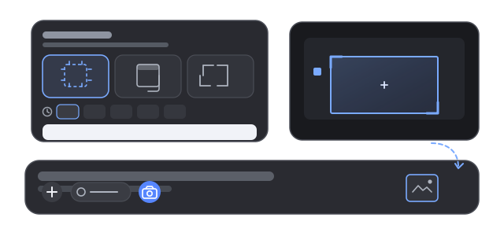

English | [中文](README.zh.md)

# dsh-windows-screenshot

Windows-native area, window, and full-screen screenshots with an optional
delay — attached directly to the DeepSeek Harness composer.

A camera button appears in the composer's left tool row. Pick a mode and delay,
then capture; the PNG lands in the current chat draft as a normal image
attachment, ready to send.



## Features

- **Area** — drag a rectangle over a frozen desktop snapshot.
- **Window** — hover/click any top-level window; the full window is captured
  with `PrintWindow(PW_RENDERFULLCONTENT)` even when covered. Falls back to the
  frozen desktop crop when a window returns a blank frame.
- **Full screen** — captures the complete Windows virtual desktop, including all
  monitors.
- **Delay** — off, 1, 3, 5, or 10 seconds; the countdown pill offers an `Esc`
  cancel.
- Native WinForms overlay: dark scrim, crosshair, window highlight, selection
  size readout, `Esc` / right-click cancel.
- The DSH window is brought back to the foreground after capture.
- Screenshots are saved under `$DSH_HOME/screenshots` and attached to the
  current draft automatically.
- The last mode and delay are remembered per browser.

## Requirements

- Windows 10 or 11.
- Windows PowerShell 5.1 (built in) and .NET Framework 4.x.
- DSH `0.2.2-rc.1` through `0.2.x`. Tested on DSH `0.2.2-rc.3` at 150% DPI with a
  multi-monitor virtual desktop.

## Install

From GitHub:

```sh
dsh plugin --profile web add github:KevinMKRL/dsh-windows-screenshot
```

Use your actual profile name instead of `web` when it differs (for example
`desktop`). Enable the bundle in **Plugins** if it is not enabled automatically,
then restart DSH if the host half was just installed.

There is no npm package yet; this is a source-installable bundle. A versioned
tarball is also attached to [GitHub Releases](https://github.com/KevinMKRL/dsh-windows-screenshot/releases).

## Use

1. Open a chat and click the camera button in the composer's left tool row.
2. Choose **Area**, **Window**, or **Full screen**.
3. Choose a delay. With a delay, switch to the target window during the
   countdown. With **Off**, the frozen desktop is captured immediately.
4. Press **Start capture** and finish the native selection.
5. The screenshot appears in the composer as an image attachment.

> With delay **Off**, the DSH window stays where it is, so a full-screen capture
> includes DSH itself. Use a delay to capture another application first.

The chooser, tooltips, errors, and the native overlay follow DSH's active
language. English and Simplified Chinese are included; other DSH languages fall
back to English.

## Permissions and privacy

- The plugin captures the screen only after you press **Start capture**.
- It spawns a local Windows PowerShell process to draw the overlay and save the
  PNG; no screenshot data is sent over the network.
- The Host registers a token-protected loopback HTTP route used by the same DSH
  page to start a capture and fetch the resulting image.
- The finished PNG is stored under `$DSH_HOME/screenshots` and enters the
  ordinary DSH attachment upload path of the current session.
- No credentials, telemetry, or external endpoints are used.

See [SECURITY.md](SECURITY.md) for the full local trust model.

## Why not `SnippingTool.exe`?

The built-in Snipping Tool cannot be commanded to a selected mode and delay, and
it has no supported way to return the finished image to a caller. This plugin
therefore draws the same kind of native Windows overlay with WinForms/GDI, so the
mode/delay chooser and automatic composer import are possible. It uses only
Windows APIs and the system PowerShell.

## Notes and limitations

- Full screen captures the complete virtual desktop, including every monitor.
- Hardware-accelerated windows can occasionally return a blank `PrintWindow`
  image; the plugin then falls back to cropping the frozen desktop snapshot.
- The camera button is placed in the public `conversation.input.left` slot. DSH
  renders that slot after the permission/plan chips, so the camera sits at the
  right edge of that left control group rather than immediately touching the `+`.
- The plugin is Windows-only; other platforms get a clear error if the host is
  selected.

## Uninstall

Disable or remove the bundle in **Plugins**. The plugin writes no configuration
outside its package; screenshots already saved under `$DSH_HOME/screenshots`
remain yours to delete.

## License

MIT. See [LICENSE](LICENSE).
