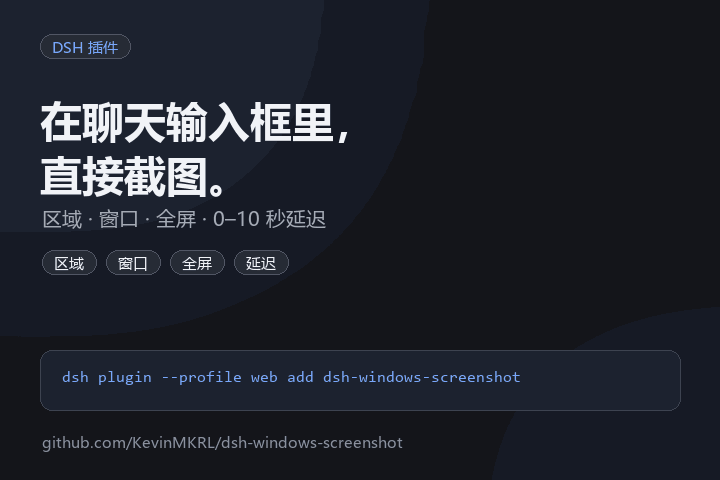

[English](README.md) | 中文

# dsh-windows-screenshot

[](https://github.com/KevinMKRL/dsh-windows-screenshot/releases)
[](https://www.npmjs.com/package/dsh-windows-screenshot)
[](https://github.com/KevinMKRL/dsh-windows-screenshot)
[](https://github.com/deepseek-ai/deepseek-harness)
[](LICENSE)

给 DeepSeek Harness 输入框加一个 Windows 原生截图按钮，支持区域、窗口、全屏和延迟，截完自动加入当前聊天草稿。

点击输入框左侧工具栏的相机按钮，选择模式和延迟后开始截图；PNG 会作为普通图片附件进入当前输入框，可以直接发送。



## 安装

从 npm 安装（推荐）：

```sh
dsh plugin --profile web add dsh-windows-screenshot
```

从 GitHub 安装：

```sh
dsh plugin --profile web add github:KevinMKRL/dsh-windows-screenshot
```

如果你的 profile 不叫 `web`（例如 `desktop`），把命令里的 `web` 换成实际 profile 名。安装后在 **插件** 页启用组合包；如果刚安装 Host 半，需要重启 DSH。

## 功能

- **区域**：在冻结的桌面画面上拖拽框选。
- **窗口**：悬停并点击任意顶层窗口，使用 `PrintWindow(PW_RENDERFULLCONTENT)` 截取完整窗口（被遮挡也可以）。如果窗口返回空白画面，会回退为从冻结桌面上裁剪。
- **全屏**：截取整个 Windows 虚拟桌面，包含所有显示器。
- **延迟**：无、1 秒、3 秒、5 秒、10 秒；倒计时会显示提示，可按 `Esc` 取消。
- Windows 原生 WinForms 遮罩：暗色背景、十字光标、窗口高亮、选区尺寸读数，`Esc` / 右键取消。
- 截图结束后自动把 DSH 窗口切回前台。
- 截图保存在 `$DSH_HOME/screenshots`，并自动加入当前草稿。
- 上次使用的模式和延迟会分别保存在浏览器本地。

## 要求

- Windows 10 或 11。
- Windows PowerShell 5.1（系统自带）和 .NET Framework 4.x。
- DSH `0.2.2-rc.1` 到 `0.2.x`。已在 DSH `0.2.2-rc.3`、150% 缩放、多显示器虚拟桌面上测试。

## 使用

1. 打开一个聊天，点击输入框左侧工具栏的相机按钮。
2. 选择 **区域 / 窗口 / 全屏**。
3. 选择延迟。有延迟时，在倒计时期间切换到目标窗口；选择 **无** 时会立即截取当前冻结画面。
4. 点 **开始截图**，完成原生遮罩里的选择。
5. 截图会以图片缩略图出现在输入框里。

> 选择 **无** 时 DSH 窗口不会让开，所以全屏截图会把 DSH 自己也截进去。要截其它程序，请先选延迟并在倒计时里切过去。

选择面板、提示、错误信息和 Windows 原生遮罩都会跟随 DSH 当前语言。内置英文和简体中文；DSH 的其他语言回退到英文。

## 权限与隐私

- 只有点击 **开始截图** 后才会截屏。
- 插件会启动一个本地 Windows PowerShell 进程绘制遮罩并保存 PNG，截图数据不会发送到网络。
- Host 注册了一个带 token 的本机回环 HTTP 路由，只供同一个 DSH 页面启动截图和取回图片。
- PNG 保存在 `$DSH_HOME/screenshots`，然后走当前会话的普通 DSH 附件上传流程。
- 不使用任何凭据、遥测或外部接口。

完整的本地信任模型见 [SECURITY.md](SECURITY.md)。

## 为什么不直接调用 `SnippingTool.exe`？

系统自带的截图工具无法通过脚本指定“区域/窗口/全屏 + 延迟”，也没有受支持的接口把结果交回调用方。因此本插件用 WinForms/GDI 绘制同类型的 Windows 原生遮罩，才能实现模式和延迟选择，并自动导入输入框；它只使用 Windows API 和系统 PowerShell。

## 说明与限制

- 全屏模式会截整个虚拟桌面，包含所有显示器。
- 个别硬件加速窗口的 `PrintWindow` 可能返回空白，此时会回退为从冻结的桌面截图里裁剪该窗口。
- 相机按钮放在公开的 `conversation.input.left` 插槽里；DSH 会把它渲染在权限/计划控件之后，所以它位于左侧控件组的最右边，而不是紧贴加号。
- 插件仅支持 Windows；其他平台上如果被选中会给出明确错误。

## 兼容性反馈

在 README 列出的 DSH 版本之外也试过？欢迎开 issue 附上 DSH 版本、Windows 版本和三种模式的结果。反馈会帮助社区市场把插件标记为已验证。

## 卸载

在 **插件** 页禁用或移除组合包即可。插件不在包外写配置；`$DSH_HOME/screenshots` 里已经保存的截图需要你自己删除。

## 许可证

MIT，见 [LICENSE](LICENSE)。
